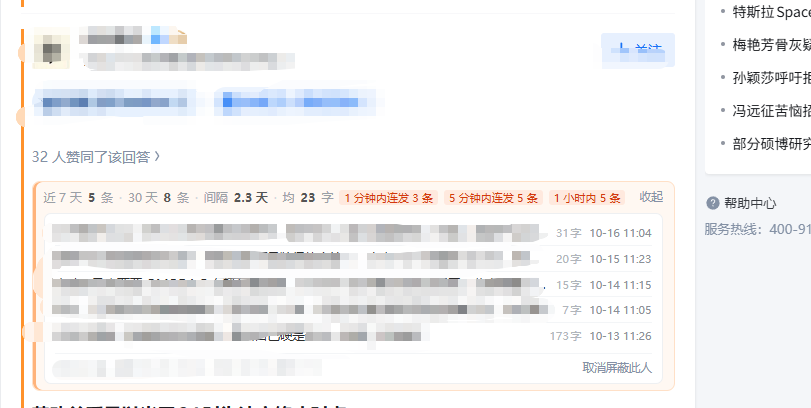
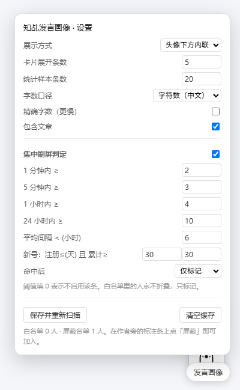

# 知乎发言画像

**读一篇回答之前，先看一眼这个人是怎么发东西的。**

在知乎答主的昵称下方加一行小字：近 7 天 / 30 天发了几条、平均间隔多久、每条多少字。点开能看到最近几条的标题、具体时间、字数。命中「短时间连发」之类的规则时，那一行会变成橙色。

## 为什么做这个

起因很具体。

搜一个问题，连着翻了几篇回答，每篇都结构工整、语气中性、信息密度均匀，读到最后一句才发现——没有任何个人经历，没有具体的时间地点人物，通篇是「一方面…另一方面…总的来说」。是 AI 批量生成的软文。

举报了，没有下文。这类内容严格来说不违规：没有虚假信息，没有辱骂，只是空洞。平台很难逐条判定「这篇是不是机器写的」，也很难为此付出审核成本。指望平台解决，基本没戏。

那就换个角度：**内容层面判断不了，就看这个账号是怎么发东西的。**

一个认真写回答的人，一天顶多写一两条，写一条要小半天，动辄上千字。而一个批量投喂的账号，可能一天几十条，每条几十字，间隔几分钟，从早到晚不停。这些是能被量化的行为特征，而且不需要任何权限——知乎的公开接口就给了。

所以有了这个脚本。它是 vibe coding 的产物：需求很窄，实现也就一个文件。

### 它不做什么（先说清楚）

**它不判断一篇内容是不是 AI 写的，也不是「AI 检测器」。**

文本层面的 AI 判定本身不可靠：同一个人写的、改过的、不同模型输出的，都可能误判。拿这种判断去给一个真实用户贴标签，是不负责任的。

脚本只提供**可核查的事实**：发了多少条、多久发一次、每条多长、最近都发了什么。至于这些数字意味着什么，你自己看。

## 长什么样

### 折叠态（默认，就一行）

不打扰阅读，跟页面里的灰色小字融为一体：

`近 7 天 4 条 · 30 天 11 条 · 间隔 3.5 天 · 均 1480 字` —— 典型的认真写作者：一周几条，一条上千字。

### 展开：最近发言

点「最近 5 条 ▾」，每条压成一行，时间具体到分钟（就是开头那张图）。

图中那次命中了规则：底色转暖、左侧一条橙线，后面跟几个红标签（`1 分钟内连发 3 条`、`5 分钟内连发 5 条`、`1 小时内 5 条`）。底下几行是最近发言，每条只有几十字到一百多字，前后间隔几分钟——这种「高频 + 短篇」的组合，跟认真写回答的人差别很明显。

### 设置

右下角「发言画像」按钮打开，阈值全部可调：

## 功能

### 发言统计

- 近 7 天 / 近 30 天条数、平均发言间隔
- 平均 / 中位 / 最长正文字数
- 注册天数、历史日均、累计条数
- 回答与文章合并统计，按时间混排

### 最近发言

- 标题、类型（回答 / 文章）、具体时间（到分钟）、正文字数
- 字数按字符数统计；接口只返回摘要时，数字前标 `≈`

### 集中刷屏判定

用滑动窗口算「任意时间窗内的最大条数」，所以能抓到「同一分钟连发」这种按天分桶抓不到的情况：

| 规则 | 默认阈值 |
| --- | --- |
| 1 分钟内 ≥ N 条 | 2 |
| 5 分钟内 ≥ N 条 | 3 |
| 1 小时内 ≥ N 条 | 4 |
| 24 小时内 ≥ N 条 | 10 |
| 平均间隔 < N 小时（样本 ≥ 5） | 6 |
| 注册 ≤ 30 天且累计 ≥ 30 条 | 新号高产 |
| 平均 < 50 字且近 30 天 ≥ 10 条 | 短句灌水 |

阈值填 0 就是关掉那条规则。

### 命中之后怎么处理

- `仅标记`（默认）：回答不动，只加橙线
- `折叠`：回答收起，顶部留一条 `已折叠：1 小时内连发 6 条｜展开｜不再屏蔽`
- `隐藏`：整个回答从页面消失

也可以直接点面板上的「屏蔽此人」手动拉黑某个账号；白名单里的账号只标记、永不折叠。

## 安装

1. 浏览器装 [Tampermonkey](https://www.tampermonkey.net/)（Chrome / Edge / Firefox 都行）
2. 点 Tampermonkey 图标 →「添加新脚本」→ 把 [`zhihu-voice-insight.user.js`](./zhihu-voice-insight.user.js) 的内容整段粘贴进去覆盖 → 保存
3. 首次运行会弹一次授权确认（`www.zhihu.com` 等域名），点允许

## 使用

- 打开任意知乎页面（首页推荐流、问题页、回答页、专栏），自动标注；翻页和无限滚动会自动补扫
- 右下角「发言画像」按钮：调阈值、改展示方式、重新扫描、清缓存
- 油猴菜单命令：

| 命令 | 作用 |
| --- | --- |
| 启用 / 暂停标注 | 临时关掉，不占资源 |
| 切换展开条数 | 4 / 6 / 10 / 15 循环 |
| 清空缓存 | 强制重新请求 |
| 控制台自检 | 打印接口返回的原始长度与字数，排查取数问题 |

## 判定规则会误伤哪些人

诚实说，这套规则只看行为，不看内容，所以一定会误伤：

- **专栏作者、搬运号**：本来就更新得勤，一天几条很正常
- **热点期答主**：时事类问题一出来，集中回答几条，会被判成「1 小时内连发」
- **多人共用的机构号**：几个人轮流发，间隔自然很短
- **短回答爱好者**：有人就是爱写一两句话，字数少但不代表是机器

这些情况跟 AI 没有关系。所以默认动作是「仅标记」——先看见，别急着折叠。用一段时间觉得准了，再调到折叠或隐藏。

## 数据与隐私

- 数据来自知乎公开接口 `api/v4`，用的是你浏览器里现有的登录态，不涉及任何额外的账号或密钥
- 脚本只读：不点赞、不关注、不发私信、不改动任何内容
- 不向知乎以外的任何地址发请求，不上传、不统计、不回传
- 结果缓存在本地（Tampermonkey 存储），30 分钟后过期

接口被拦（签名校验等）时会自动退回抓取 `/people/{token}/answers` 页面并解析其中的 `js-initialData`，不至于整个失效。正文字数依赖接口返回完整 `content`；列表接口默认只给摘要，脚本已显式传 `include=data[*].content`，仍拿不到时字数前标 `≈`。

## 排查

**字数明显不对，或一直显示 `≈`**

点油猴菜单的「控制台自检」，看 `content 原始长度`。稳定在 100 上下说明 `include` 参数没生效；接近真实正文长度说明接口确实只给了摘要。

**面板位置错乱**（压住昵称、挤在头像旁边）

脚本靠「从作者链接向上找含正文块的祖先」定位卡片，个别页面结构需要补选择器。提 issue 时带上页面类型和截图。

**一个回答下面出现两条面板**

已在 2.5.0 修掉（同一作者的头像链接和昵称链接被当成两个人）。若还出现，说明页面结构有变，附截图提 issue。

## 许可

MIT，见 [LICENSE](./LICENSE)。

仅用于改善自己的阅读体验，请遵守知乎的用户协议。不要用它做批量抓取、人肉或公开挂人——那些都不是这个工具的目的。

## 更新记录

- **2.5.0** 修复同一张卡片生成两条面板（头像链接与昵称链接被当成两个人）
- **2.4.0** 发言时间改为具体日期 + 到分钟，不再显示「x 天前」
- **2.3.0** 面板加淡底色，命中规则时转暖底 + 左侧橙线
- **2.2.0** 修面板被塞进 360px 窄容器导致折行；视觉重做为整宽一行
- **2.1.0** 修面板被插入 flex 作者行导致遮住昵称
- **2.0.0** 改内联标注 + 滑窗刷屏判定 + 屏蔽；修复字数统计（此前错把摘要当正文）
- **1.0.0** 悬停卡片版
